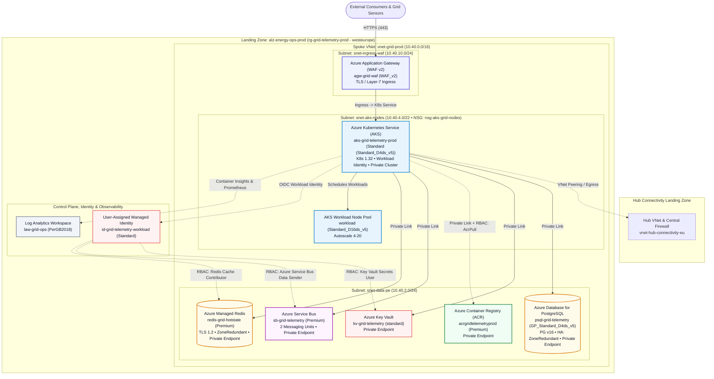

# Grid Telemetry & Dispatch Service (`grid-telemetry-service`)

Ingests high-frequency substation voltage, frequency, and thermal telemetry and exposes real-time grid dispatch health APIs.

**[Open the interactive Doc as Code workshop](https://gitpavleenbali.github.io/dac-workload-modernization/).** Start with the [workload-to-platform overview](https://gitpavleenbali.github.io/dac-workload-modernization/#cross-team-flow), then follow the Why, What, and [How](https://gitpavleenbali.github.io/dac-workload-modernization/#how-story) comics. Use **Present** for the slide decks, including [commit IDs and architecture hashes](https://gitpavleenbali.github.io/dac-workload-modernization/#fingerprints). The [Evidence & Links tour](https://gitpavleenbali.github.io/dac-workload-modernization/#evidence-tour) connects the in-page diagrams and comparisons to the GitHub records.

This repository is the workload source. The starting design on `main` hosts the Grid Telemetry application on Azure virtual machines (VMs). As part of modernization, [workload PR #1](https://github.com/gitpavleenbali/dac-workload-modernization/pull/1/files) proposes running the same application in containers on Azure Kubernetes Service (AKS). The code and diagrams describe two designs in Git, not a live deployment.

The deployment quickstart illustrates the declared hosting design. The workshop does not provision Azure resources or publish a container image.

## Current Hosting & Landing Zone Summary

<!-- BEGIN DAC:local-hosting-summary source="gitpavleenbali/dac-workload-modernization@a77df6d1846443937999c73a3fe23eb50c8be9d6" irHash="9d0955415321" -->
| Attribute | Current Value (Extracted from IaC & Manifests) |
| :--- | :--- |
| **Service** | **Grid Telemetry & Dispatch Service** (`grid-telemetry-service`) |
| **Hosting Paradigm** | **Azure Kubernetes Service (Cloud-Native Containers)** |
| **Landing Zone / RG** | `alz-energy-ops-prod` / `rg-grid-telemetry-prod` (`westeurope`) |
| **IaC Definitions** | `terraform`, `bicep` |
| **Topology Semantic Hash** | `9d095541532117cb` |
<!-- END DAC:local-hosting-summary -->

## Landing Zone Architecture Diagram

<!-- BEGIN DAC:local-topology-diagram source="gitpavleenbali/dac-workload-modernization@a77df6d1846443937999c73a3fe23eb50c8be9d6" irHash="9d0955415321" -->

<!-- END DAC:local-topology-diagram -->

## Build, Validate & Deploy Quickstart

<!-- BEGIN DAC:local-build-deploy source="gitpavleenbali/dac-workload-modernization@a77df6d1846443937999c73a3fe23eb50c8be9d6" irHash="9d0955415321" -->
```bash
# 1. Run application & DaC translator test suites
npm test

# 2. Build & push container image to Azure Container Registry (acrgridtelemetryprod)
docker build -t acrgridtelemetryprod.azurecr.io/grid-telemetry-service:latest .
az acr login --name acrgridtelemetryprod
docker push acrgridtelemetryprod.azurecr.io/grid-telemetry-service:latest

# 3. Validate Terraform & apply Kubernetes manifests to AKS (aks-grid-telemetry-prod)
terraform -chdir=infra/terraform init -backend=false && terraform -chdir=infra/terraform validate
az aks get-credentials --resource-group rg-grid-telemetry-prod --name aks-grid-telemetry-prod
kubectl apply -f deploy/k8s/
```
<!-- END DAC:local-build-deploy -->

## REST API Surface

<!-- BEGIN DAC:local-api-endpoints source="gitpavleenbali/dac-workload-modernization@a77df6d1846443937999c73a3fe23eb50c8be9d6" irHash="9d0955415321" -->
| HTTP Method | Endpoint Path | Capability Summary |
| :--- | :--- | :--- |
| `GET` | `/healthz` | Kubernetes liveness and readiness probe returning pod runtime mode and buffer depth |
| `GET` | `/v1/grid/status` | Retrieve current regional grid nominal frequency, active frequency-deviation alerts, and latest substation reading |
| `POST` | `/v1/telemetry` | Idempotently ingest single substation voltage and frequency telemetry reading |
| `POST` | `/v1/telemetry/batch` | Asynchronously enqueue high-frequency substation telemetry batch via Azure Service Bus Premium |
| `POST` | `/v1/dispatch/curtailment` | Issue automated substation load-curtailment dispatch command during grid frequency excursion |
| `GET` | `/v1/telemetry/recent` | List most recent 25 telemetry readings in the active window |
<!-- END DAC:local-api-endpoints -->

## Developer Notes & Local Environment (Human-Maintained)

- **Local Port:** `PORT=8080 npm start` launches the HTTP telemetry server locally with an in-memory ring buffer when PostgreSQL is unreachable.
- **Docs-as-Code Contract:** After infrastructure or manifest edits, run `npm run dac:render` and commit the generated Markdown with the workload change. GitHub Actions verifies the files and previews the architecture change.

## Refresh the existing documents

After changing a supported infrastructure, deployment, or OpenAPI declaration, the same commands update and check the workload documents:

```sh
npm run dac:render
npm run dac:verify
npm test
git diff -- README.md docs/architecture.md
```

`dac:render` replaces the marked `BEGIN DAC` / `END DAC` sections in `README.md` and [`docs/architecture.md`](docs/architecture.md). It leaves the surrounding prose alone. Commits carry the generated updates with the source change; ordinary GitHub Actions runs verify freshness but do not rewrite or publish the files.

## The portable core and the optional agent paths

**Option 1 is the foundation.** The Node.js 20+ translator reads a checkout from GitHub, Azure DevOps, or Bitbucket. Extracting, rendering, and verifying need neither an AI model nor a Git-host API. This repository verifies GitHub Actions. Azure Pipelines and Bitbucket Pipelines can call the same commands after checkout; their workflow configuration and any host-native pull request publisher are separate integrations. The publisher included here targets GitHub.

### Run the Option 1 workshop demo

From this repository root, paste one command at a time:

```powershell
npm run demo:option1:baseline
npm run demo:option1:prepare
npm run demo:option1:render
npm run demo:option1:clean
```

1. **Baseline** creates `dac-option1-vm-baseline` with matching VM code and VM documentation, verifies it, and prints the exact code, diagram, and Markdown locations to show.
2. **Prepare** creates a separate `dac-option1-demo` checkout with AKS code and old VM docs. The stale-document failure is expected and explained in the terminal. In the existing parent VS Code workspace, expand `dac-option1-demo`; do not demonstrate the README in `dac-workload-modernization`, because that feature branch already contains the rendered AKS documentation. Confirm the demo README shows **Azure Virtual Machines (IaaS)** before rendering.
3. **Render** updates the same `README.md` and `docs/architecture.md`, verifies both Mermaid blocks, runs the tests, and prints exactly what to show in VS Code. It never pushes.
4. **Clean** removes both registered disposable worktrees. It refuses to delete either one if an unexpected file changed.

For the local Copilot demonstration, use the isolated Option 2A helper:

```powershell
npm run demo:option2a:prepare
npm run demo:option2a:check
npm run demo:option2a:clean
```

The helper pairs the AKS proposal code with the old VM versions of `README.md` and `docs/architecture.md`, creating the same visible drift as Option 1. Open the printed `dac-option2a-agent-demo` checkout in a separate VS Code window, select the `dac-architecture-guardian` custom agent in Copilot Chat, and ask it to use the `refresh-workload-docs` skill. The independent check verifies the resulting local AKS documentation diff; nothing commits or pushes. To download the verified Option 2B workload and central review-patch artifacts from the recorded successful GitHub runs, use `npm run demo:option2b:evidence`.

For central publication, run the [workload workflow](https://github.com/gitpavleenbali/dac-workload-modernization/actions/workflows/dac-translator-sync.yml) on `feat/modernize-vm-to-aks`, select **Update the central docs PR**, and leave **Option 2** unchecked.

| Path | What it produces | Workshop evidence |
| --- | --- | --- |
| **1 · Deterministic translator** | The same rules refresh the existing diagrams and Markdown. An authorized opt-in sync separately updates the rolling central pull request. | [Workload PR #1](https://github.com/gitpavleenbali/dac-workload-modernization/pull/1/files) → [central docs PR #1](https://github.com/gitpavleenbali/dac-central-platform-docs/pull/1/files). [Workload sync](https://github.com/gitpavleenbali/dac-workload-modernization/actions/runs/44972624473) and [central check](https://github.com/gitpavleenbali/dac-central-platform-docs/actions/runs/44972674206). |
| **2A · Spec-driven local Copilot** | Copilot follows the spec, runs the same translator and checks, and leaves a diff in the workload checkout. It does not push. | [Local walkthrough and recorded scaling change](https://gitpavleenbali.github.io/dac-workload-modernization/#option-two-local). |
| **2B · GitHub cloud agentic delivery** | Two GitHub-hosted paths: an Agentic Workflow uses verified facts to attach unapplied review patches in both repositories; a separate Copilot Cloud Agent session drafts ADR-003 in its own draft PR. Neither path regenerates diagrams, deploys, approves, or merges. | [Workload Agentic Workflow run](https://github.com/gitpavleenbali/dac-workload-modernization/actions/runs/44971666753) → [central run](https://github.com/gitpavleenbali/dac-central-platform-docs/actions/runs/44972101526); [Cloud Agent issue #2](https://github.com/gitpavleenbali/dac-central-platform-docs/issues/2) → [draft PR #3](https://github.com/gitpavleenbali/dac-central-platform-docs/pull/3/files) → [validation](https://github.com/gitpavleenbali/dac-central-platform-docs/actions/runs/44890039831). |

The [local spec](specs/doc-as-code/refresh-workload-docs.md) defines what Option 2A can change. It is used with the [repository instructions](.github/copilot-instructions.md), [custom agent](.github/agents/dac-architecture-guardian.agent.md), [skill](.github/skills/refresh-workload-docs/SKILL.md), and [VS Code prompt](.github/prompts/refresh-workload-docs.prompt.md). The local Option 2A rehearsal uses the same AKS-code/VM-document mismatch as Option 1, but the custom agent coordinates the renderer and checks through VS Code Copilot Chat.

The repository owner can opt in to sync on the migration branch in the [workload workflow](https://github.com/gitpavleenbali/dac-workload-modernization/actions/workflows/dac-translator-sync.yml). For Option 1, select **Update the central docs PR** only. For Option 2B, select both options. Azure AI Foundry inference uses GitHub OpenID Connect (OIDC) rather than a static inference token or API key; the central publisher uses separate scoped GitHub credentials. None of these paths deploy the workload or merge a PR.

The [central repository](https://github.com/gitpavleenbali/dac-central-platform-docs) owns the shared catalog and audience guides. The [workshop source](docs/workshop-presentation/dac.html) and its allowlisted assets are packaged with `node scripts/doc-as-code/package-site.mjs .dac-out/site`. The [Pages workflow](.github/workflows/publish-doc-as-code.yml) deploys the site only when dispatched from `main`.
