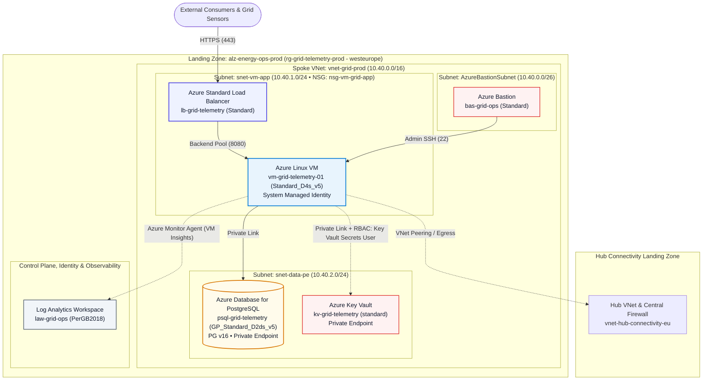

# Grid Telemetry & Dispatch Service (`grid-telemetry-service`)

Ingests high-frequency substation voltage, frequency, and thermal telemetry and exposes real-time grid dispatch health APIs.

## Current Hosting & Landing Zone Summary

<!-- BEGIN DAC:local-hosting-summary source="gitpavleenbali/dac-workload-modernization@v1.0.0-vm-baseline" irHash="e8147f08f46c" -->
| Attribute | Current Value (Extracted from IaC & Manifests) |
| :--- | :--- |
| **Service** | **Grid Telemetry & Dispatch Service** (`grid-telemetry-service`) |
| **Hosting Paradigm** | **Azure Virtual Machines (IaaS)** |
| **Landing Zone / RG** | `alz-energy-ops-prod` / `rg-grid-telemetry-prod` (`westeurope`) |
| **IaC Definitions** | `terraform`, `bicep` |
| **Topology Semantic Hash** | `e8147f08f46cc101` |
<!-- END DAC:local-hosting-summary -->

## Landing Zone Architecture Diagram

<!-- BEGIN DAC:local-topology-diagram source="gitpavleenbali/dac-workload-modernization@v1.0.0-vm-baseline" irHash="e8147f08f46c" -->

<!-- END DAC:local-topology-diagram -->

## Build, Validate & Deploy Quickstart

<!-- BEGIN DAC:local-build-deploy source="gitpavleenbali/dac-workload-modernization@v1.0.0-vm-baseline" irHash="e8147f08f46c" -->
```bash
# 1. Run application & DaC translator test suites
npm test

# 2. Validate Virtual Machine Landing Zone Terraform
terraform -chdir=infra/terraform init -backend=false && terraform -chdir=infra/terraform validate

# 3. Package & deploy systemd service to Linux VM (vm-grid-telemetry-01)
tar -czf dist-grid-telemetry.tar.gz src/ package.json deploy/systemd/grid-telemetry.service
az network bastion ssh --name bas-grid-ops --resource-group rg-grid-telemetry-prod --target-resource-id <vm-id> --auth-type AAD
```
<!-- END DAC:local-build-deploy -->

## REST API Surface

<!-- BEGIN DAC:local-api-endpoints source="gitpavleenbali/dac-workload-modernization@v1.0.0-vm-baseline" irHash="e8147f08f46c" -->
| HTTP Method | Endpoint Path | Capability Summary |
| :--- | :--- | :--- |
| `GET` | `/healthz` | Liveness and readiness probe returning active runtime mode and buffer depth |
| `GET` | `/v1/grid/status` | Retrieve current regional grid nominal frequency, active frequency-deviation alerts, and latest substation reading |
| `POST` | `/v1/telemetry` | Idempotently ingest substation voltage and frequency telemetry reading |
| `GET` | `/v1/telemetry/recent` | List most recent 25 telemetry readings in the active window |
<!-- END DAC:local-api-endpoints -->

## Developer Notes & Local Environment (Human-Maintained)

- **Local Port:** `PORT=8080 npm start` launches the HTTP telemetry server locally with an in-memory ring buffer when PostgreSQL is unreachable.
- **Docs-as-Code Contract:** After infrastructure or manifest edits, run `npm run dac:render` and commit the generated Markdown with the workload change. GitHub Actions verifies the files and previews the architecture change.

## GitHub demo: VM to AKS

After changing infrastructure or deployment files, run these commands from this repository:

```sh
npm run dac:render
npm run dac:verify
npm test
git diff -- README.md docs/architecture.md
```

`dac:render` updates the marked sections in the existing `README.md` and `docs/architecture.md`. It does not push, deploy, or use an LLM. Commit the docs with the workload change; the PR workflow rejects stale generated sections.

1. **Option 1 — DAC Translator:** [Workload PR #1](https://github.com/gitpavleenbali/dac-workload-modernization/pull/1/files) shows the VM-to-AKS code and docs change. Run the [workload workflow](https://github.com/gitpavleenbali/dac-workload-modernization/actions/workflows/dac-translator-sync.yml) on `feat/modernize-vm-to-aks` with **Update the central docs PR** selected and **Option 2** unchecked. Build, tests, Terraform, and DaC checks precede the update to [Central Docs PR #1](https://github.com/gitpavleenbali/dac-central-platform-docs/pull/1/files).
2. **Option 2 — Copilot in CI:** On that workflow, select both checkboxes. Or, as the owner, add the `dac-agentic` label to the same-repository migration PR to opt in on that event and subsequent pushes. After the same checks, Copilot proposes a verified Markdown patch to the existing workload architecture page. CI then updates the central docs PR, where another verified patch is proposed after central quality checks. Proposals are run artifacts for human review; neither agent commits to a branch. Both repos need a [Copilot inference secret](https://github.github.com/gh-aw/reference/auth/#copilot_github_token) for this mode.
3. **Option 2 — Copilot Cloud Agent on demand:** The [ADR task](https://github.com/gitpavleenbali/dac-central-platform-docs/issues/2) demonstrates a separate path. Copilot proposes a standalone decision record in a draft PR. It doesn't own the generated diagrams or guides.

Both demos document the intended architecture; neither deploys Azure resources. Azure DevOps teams can call the same `dac-translator` CLI from their own pipelines with a scoped GitHub credential for central PRs. No Azure Pipelines workflow is required for this demo.
