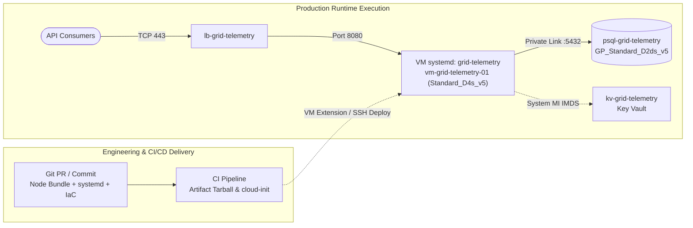

# Grid Telemetry & Dispatch Service — Repository Architecture & Delivery View

This page documents the declarations in the checked-out revision, not verified Azure deployment or connectivity. The diagram includes intended delivery and runtime paths. This repository's Doc as Code workflow tests and validates those changes; it does not push images or deploy them. See the [workshop's before/after comparison](https://gitpavleenbali.github.io/dac-workload-modernization/#file-comparison) for the VM baseline, the AKS proposal, and the central review.

## Runtime & CI/CD Delivery Flow

<!-- BEGIN DAC:local-runtime-diagram source="gitpavleenbali/dac-workload-modernization@v1.0.0-vm-baseline" irHash="e8147f08f46c" -->

<!-- END DAC:local-runtime-diagram -->

## Spoke VNet & Subnet Layout

<!-- BEGIN DAC:local-subnet-table source="gitpavleenbali/dac-workload-modernization@v1.0.0-vm-baseline" irHash="e8147f08f46c" -->
| Subnet Name | CIDR Prefix | Attached NSG | Service Delegation | Hosted / Connected Resources |
| :--- | :--- | :--- | :--- | :--- |
| `snet-vm-app` | `10.40.1.0/24` | `nsg-vm-grid-app` | `None` | `lb-grid-telemetry`, `vm-grid-telemetry-01` |
| `AzureBastionSubnet` | `10.40.0.0/26` | `Platform Default` | `None` | `bas-grid-ops` |
| `snet-data-pe` | `10.40.2.0/24` | `Platform Default` | `None` | `psql-grid-telemetry`, `kv-grid-telemetry` |
<!-- END DAC:local-subnet-table -->

## Provisioned Azure Resources

<!-- BEGIN DAC:local-resource-inventory source="gitpavleenbali/dac-workload-modernization@v1.0.0-vm-baseline" irHash="e8147f08f46c" -->
| Azure Resource Name | Architectural Type | Category | SKU / Sizing | Subnet / Scope | Key Capabilities |
| :--- | :--- | :--- | :--- | :--- | :--- |
| `bas-grid-ops` | Azure Bastion | `security` | `Standard` | `AzureBastionSubnet` | Standard |
| `lb-grid-telemetry` | Azure Standard Load Balancer | `ingress` | `Standard` | `snet-vm-app` | Standard |
| `vm-grid-telemetry-01` | Azure Linux VM | `compute` | `Standard_D4s_v5` | `snet-vm-app` | System Managed Identity |
| `psql-grid-telemetry` | Azure Database for PostgreSQL | `data` | `GP_Standard_D2ds_v5` | `snet-data-pe` | PG v16, Private Endpoint |
| `kv-grid-telemetry` | Azure Key Vault | `security` | `standard` | `snet-data-pe` | Private Endpoint |
| `law-grid-ops` | Log Analytics Workspace | `observability` | `PerGB2018` | `rg-grid-telemetry-prod` | Standard |
<!-- END DAC:local-resource-inventory -->

## Engineering Design Notes (Human-Maintained)

- Telemetry ingestion endpoints must remain idempotent by `sensorId + timestamp` so retries across network partitions never duplicate dispatch alerts.
- Any change to database SKUs, network CIDRs, or compute hosting requires `CODEOWNERS` review in the centralized platform repository.
