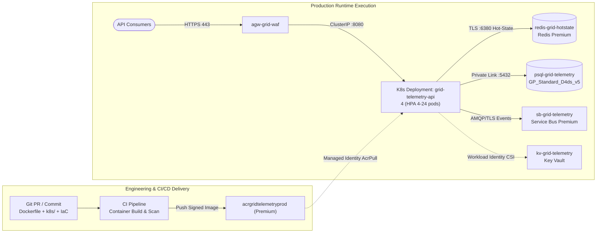

# Grid Telemetry & Dispatch Service — Repository Architecture & Delivery View

This page documents the declarations in the checked-out revision, not verified Azure deployment or connectivity. The diagram includes intended delivery and runtime paths. This repository's Doc as Code workflow tests and validates those changes; it does not push images or deploy them. See the [workshop's before/after comparison](https://gitpavleenbali.github.io/dac-workload-modernization/#file-comparison) for the VM baseline, the AKS proposal, and the central review.

## Runtime & CI/CD Delivery Flow

<!-- BEGIN DAC:local-runtime-diagram source="gitpavleenbali/dac-workload-modernization@a77df6d1846443937999c73a3fe23eb50c8be9d6" irHash="9d0955415321" -->

<!-- END DAC:local-runtime-diagram -->

## Spoke VNet & Subnet Layout

<!-- BEGIN DAC:local-subnet-table source="gitpavleenbali/dac-workload-modernization@a77df6d1846443937999c73a3fe23eb50c8be9d6" irHash="9d0955415321" -->
| Subnet Name | CIDR Prefix | Attached NSG | Service Delegation | Hosted / Connected Resources |
| :--- | :--- | :--- | :--- | :--- |
| `snet-aks-nodes` | `10.40.4.0/22` | `nsg-aks-grid-nodes` | `None` | `aks-grid-telemetry-prod`, `workload` |
| `snet-ingress-waf` | `10.40.10.0/24` | `Platform Default` | `None` | `agw-grid-waf` |
| `snet-data-pe` | `10.40.2.0/24` | `Platform Default` | `None` | `acrgridtelemetryprod`, `sb-grid-telemetry`, `redis-grid-hotstate`, `psql-grid-telemetry`, `kv-grid-telemetry` |
<!-- END DAC:local-subnet-table -->

## Provisioned Azure Resources

<!-- BEGIN DAC:local-resource-inventory source="gitpavleenbali/dac-workload-modernization@a77df6d1846443937999c73a3fe23eb50c8be9d6" irHash="9d0955415321" -->
| Azure Resource Name | Architectural Type | Category | SKU / Sizing | Subnet / Scope | Key Capabilities |
| :--- | :--- | :--- | :--- | :--- | :--- |
| `agw-grid-waf` | Azure Application Gateway (WAF v2) | `ingress` | `WAF_v2` | `snet-ingress-waf` | TLS / Layer-7 Ingress |
| `acrgridtelemetryprod` | Azure Container Registry (ACR) | `containers` | `Premium` | `snet-data-pe` | Private Endpoint |
| `id-grid-telemetry-workload` | User-Assigned Managed Identity | `security` | `Standard` | `rg-grid-telemetry-prod` | Standard |
| `aks-grid-telemetry-prod` | Azure Kubernetes Service (AKS) | `compute` | `Standard (Standard_D4ds_v5)` | `snet-aks-nodes` | K8s 1.32, Workload Identity, Private Cluster, azure (overlay) |
| `workload` | AKS Workload Node Pool | `compute` | `Standard_D16ds_v5` | `snet-aks-nodes` | Autoscale 4-20 |
| `sb-grid-telemetry` | Azure Service Bus | `messaging` | `Premium` | `snet-data-pe` | 2 Messaging Units, Private Endpoint |
| `redis-grid-hotstate` | Azure Managed Redis | `data` | `Premium` | `snet-data-pe` | TLS 1.2, ZoneRedundant, Private Endpoint |
| `psql-grid-telemetry` | Azure Database for PostgreSQL | `data` | `GP_Standard_D4ds_v5` | `snet-data-pe` | PG v16, HA: ZoneRedundant, Private Endpoint |
| `kv-grid-telemetry` | Azure Key Vault | `security` | `standard` | `snet-data-pe` | Private Endpoint |
| `law-grid-ops` | Log Analytics Workspace | `observability` | `PerGB2018` | `rg-grid-telemetry-prod` | Standard |
<!-- END DAC:local-resource-inventory -->

## Engineering Design Notes (Human-Maintained)

- Telemetry ingestion endpoints must remain idempotent by `sensorId + timestamp` so retries across network partitions never duplicate dispatch alerts.
- Any change to database SKUs, network CIDRs, or compute hosting requires `CODEOWNERS` review in the centralized platform repository.
